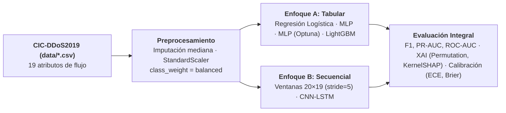
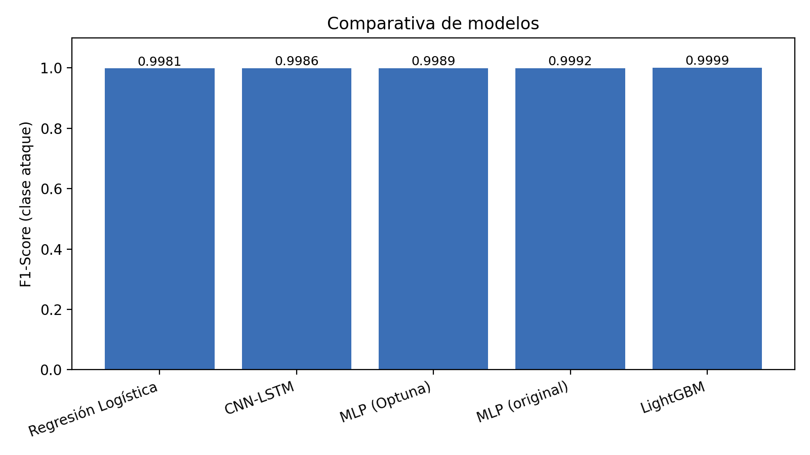

# Sistemas de Detección de Ataques DDoS basados en Deep Learning en Entornos de Red

Repositorio oficial de respaldo experimental para el póster de investigación **"Sistemas de Detección de Ataques DDoS basados en Deep Learning en Entornos de Red"**. Este proyecto implementa una arquitectura modular con [`main.py`](main.py) como nodo central de ejecución sobre los múltiples archivos CSV del dataset **CIC-DDoS2019** ubicados en la carpeta [`data/`](data/).

---
## Dataset

El proyecto utiliza el conjunto de datos **CIC-DDoS2019** (específicamente el paquete `/CSVs/CSV-01-12.zip`), cuyos archivos CSV extraídos deben ubicarse dentro del directorio `data/`. Puede descargarse desde el portal oficial del Canadian Institute for Cybersecurity (UNB): [CIC-DDoS2019 Dataset](https://www.unb.ca/cic/datasets/ddos-2019.html).

## Tabla de Contenidos

- [Sistemas de Detección de Ataques DDoS basados en Deep Learning en Entornos de Red](#sistemas-de-detección-de-ataques-ddos-basados-en-deep-learning-en-entornos-de-red)
  - [Dataset](#dataset)
  - [Tabla de Contenidos](#tabla-de-contenidos)
  - [1. Introducción](#1-introducción)
    - [Taxonomía de Enfoques del Estado del Arte (2019–2024)](#taxonomía-de-enfoques-del-estado-del-arte-20192024)
    - [Comparativo de Modelos Neuronales de la Literatura](#comparativo-de-modelos-neuronales-de-la-literatura)
    - [Brechas Identificadas](#brechas-identificadas)
  - [2. Metodología: Protocolo Común sobre CIC-DDoS2019](#2-metodología-protocolo-común-sobre-cic-ddos2019)
    - [Los 19 Atributos del Protocolo](#los-19-atributos-del-protocolo)
  - [3. Resultados Experimentales Obtenidos (`resultados_poster/`)](#3-resultados-experimentales-obtenidos-resultados_poster)
    - [3.1 Resumen del Dataset Procesado](#31-resumen-del-dataset-procesado)
    - [3.2 Comparativa Global de Modelos (`tabla_modelos.csv`)](#32-comparativa-global-de-modelos-tabla_modeloscsv)
    - [3.3 Matriz de Confusión de LightGBM en Prueba](#33-matriz-de-confusión-de-lightgbm-en-prueba)
    - [3.4 Interpretabilidad / XAI (`importancias.csv`)](#34-interpretabilidad--xai-importanciascsv)
    - [3.5 Calibración de Confianza (`calibracion.csv`)](#35-calibración-de-confianza-calibracioncsv)
    - [3.6 Comparativa de Referencia del Póster](#36-comparativa-de-referencia-del-póster)
  - [4. Arquitectura Modular](#4-arquitectura-modular)
    - [Estructura del Proyecto](#estructura-del-proyecto)
    - [Diseño de Clases y Módulos](#diseño-de-clases-y-módulos)
  - [5. Instalación y Ejecución](#5-instalación-y-ejecución)
    - [Requisitos](#requisitos)
    - [Parámetros de Línea de Comandos (`main.py`)](#parámetros-de-línea-de-comandos-mainpy)
    - [Ejemplos de Uso](#ejemplos-de-uso)
  - [6. Artefactos de Salida](#6-artefactos-de-salida)
  - [7. Referencias Principales](#7-referencias-principales)

---

## 1. Introducción

Los ataques DDoS saturan servicios críticos y camuflan su tráfico imitando patrones legítimos, haciendo que los sistemas de detección de intrusos (IDS) basados en firmas resulten insuficientes. Aunque la literatura reciente propone soluciones con **Deep Learning**, cada estudio emplea conjuntos de datos, preprocesamientos y métricas heterogéneas que impiden comparaciones directas.

Este trabajo **revisa 8 modelos neuronales del estado del arte (2019–2024)** y establece un **protocolo experimental homogéneo sobre CIC-DDoS2019** para determinar con rigor cuál arquitectura ofrece el mejor desempeño, explicabilidad y calibración probabilística.

### Taxonomía de Enfoques del Estado del Arte (2019–2024)

- **CNN pura**: Extrae patrones espaciales sin ingeniería manual de atributos (*Aktar & Nur, 2023; Pei et al., 2019*).
- **Residual (ResNet)**: Redes profundas sin degradación de gradiente orientadas a entornos IoT (*Hussain et al., 2020*).
- **Híbridos supervisados**: Combinan capas espaciales (CNN) y temporales (LSTM), integrando en ocasiones gradient boosting (*Al-zubidi et al., 2024; Mousa & Abdullah, 2023*).
- **No supervisados / probabilísticos**: Arquitecturas LSTM-Autoencoder y Bi-LSTM + GMM orientadas a ataques de día cero (*Wei et al., 2023; Shieh et al., 2021*).
- **Ensambles sobre logs**: Defensa en profundidad y análisis forense (*Musa & Odokuma, 2023*).

### Comparativo de Modelos Neuronales de la Literatura

| Trabajo | Modelo | Métrica Reportada | Recall | Limitación Principal |
| :--- | :--- | :---: | :---: | :--- |
| **Al-zubidi et al. (2024)** | **CNN-LSTM-XGBoost** | **Acc 99.86%** | **97.0%** | Complejidad alta (3 modelos integrados) |
| Mousa & Abdullah (2023) | LSTM-CNN | F1 97.40% | 97.3% | Mayor latencia; solo datos simulados |
| Musa & Odokuma (2023) | Ensamble ML+DL (logs) | Prec. 97.0% | 95.0% | Latencia alta; no opera por paquete |
| Aktar & Nur (2023) | CNN | Acc 99.50% | n/d | Caja negra; sin F1 ni Recall |
| Wei et al. (2023) | LSTM-Autoencoder | AUC 0.996 | 93.0% | Recall bajo; sensible al umbral |
| Shieh et al. (2021) | Bi-LSTM + GMM | Acc 99.40% | n/d | Costo prohibitivo en tiempo real |
| Hussain et al. (2020) | ResNet (IoT) | Acc 99.78% | 94.0% | Pesado para nodos IoT |
| Pei et al. (2019) | CNN (TCP Flood) | Acc 99.93% | n/d | No generaliza más allá de TCP Flood |

### Brechas Identificadas

1. **Recall insuficiente**: Ningún estudio reportado supera el 97.3% de sensibilidad, dejando flujos maliciosos sin detectar.
2. **Complejidad vs. despliegue**: Los modelos más precisos encadenan múltiples arquitecturas y exigen GPU; los ligeros sacrifican sensibilidad.
3. **Métricas incompletas**: Varios trabajos omiten F1-Score o Recall en escenarios altamente desbalanceados.
4. **Ausencia de interpretabilidad y calibración**: No explican en qué atributos fundamentan sus decisiones ni cuán confiable es la probabilidad estimada.
5. **Datos simulados o de nicho**: Escasa validación sobre tráfico variado y vectores múltiples.

---

## 2. Metodología: Protocolo Común sobre CIC-DDoS2019



- **Particiones estratificadas**: División global **80% entrenamiento / 10% validación / 10% prueba**.
- **Prevención de fuga de datos (*Data Leakage*)**: El imputador (`SimpleImputer(strategy="median")`) y el escalador (`StandardScaler`) se ajustan únicamente sobre la partición de entrenamiento.
- **Modelado secuencial**: Construcción de ventanas deslizantes de `SEQ_LEN = 20` flujos con salto `SEQ_STRIDE = 5`, asignando la etiqueta del último flujo de la ventana.

### Los 19 Atributos del Protocolo

1. `Flow Duration`
2. `Total Fwd Packets`
3. `Total Backward Packets`
4. `Total Length of Fwd Packets`
5. `Total Length of Bwd Packets`
6. `Fwd Packet Length Max`
7. `Fwd Packet Length Min`
8. `Fwd Packet Length Mean`
9. `Bwd Packet Length Max`
10. `Bwd Packet Length Min`
11. `Bwd Packet Length Mean`
12. `Flow Bytes/s`
13. `Flow Packets/s`
14. `Init_Win_bytes_forward`
15. `Init_Win_bytes_backward`
16. `act_data_pkt_fwd`
17. `min_seg_size_forward`
18. `Active Mean`
19. `Idle Mean`

---

## 3. Resultados Experimentales Obtenidos (`resultados_poster/`)

A continuación se documentan los resultados generados en [`resultados_poster/`](resultados_poster/) al ejecutar el pipeline completo sobre los 8 archivos CSV de ataques DrDoS en `data/`.

### 3.1 Resumen del Dataset Procesado

| Parámetro | Valor |
| :--- | ---: |
| **Flujos totales procesados** | **28,001,999** |
| **Atributos por flujo** | **19** |
| **Flujos de ataque (clase 1)** | **27,974,480** (99.90%) |
| **Flujos benignos (clase 0)** | **27,519** (0.10%) |
| **Partición de Entrenamiento (70%)** | **19,601,399** |
| **Partición de Validación (10%)** | **2,800,200** |
| **Partición de Prueba (20%)** | **5,600,400** |
| **Secuencias generadas (`20 × 19`, `stride=5`)** | **5,600,396** |

### 3.2 Comparativa Global de Modelos (`tabla_modelos.csv`)

| Modelo | Enfoque | F1-Score | Precision | Recall | PR-AUC | ROC-AUC | Accuracy | FPR |
| :--- | :---: | :---: | :---: | :---: | :---: | :---: | :---: | :---: |
| Regresión Logística | Tabular | 0.998120 | 0.999997 | 0.996250 | 1.000000 | 0.999686 | 0.996251 | 0.3270% |
| CNN-LSTM | Secuencial | 0.998592 | 0.999995 | 0.997194 | 1.000000 | 0.999523 | 0.997191 | 0.5484% |
| MLP (Optuna) | Tabular | 0.998929 | 0.999996 | 0.997865 | 0.999999 | 0.999482 | 0.997863 | 0.3815% |
| MLP (original) | Tabular | 0.999236 | 0.999992 | 0.998481 | 0.999999 | 0.999437 | 0.998475 | 0.8539% |
| **LightGBM** | **Tabular** | **0.999932** | **0.999998** | **0.999866** | **1.000000** | **0.999996** | **0.999864** | **0.1999%** |



> **Hallazgo experimental confirmado**: Bajo un protocolo homogéneo sobre CIC-DDoS2019, los modelos tabulares (**LightGBM** y **MLP**) superan al modelo híbrido secuencial **CNN-LSTM** tanto en F1-Score y Recall como en tasa de falsos positivos (FPR).

### 3.3 Matriz de Confusión de LightGBM en Prueba

Evaluación sobre **5,600,400 flujos de prueba**:

| | Predicción: Benigno | Predicción: Ataque |
| :--- | :---: | :---: |
| **Real: Benigno** | **5,493** (Verdadero Negativo) | **11** (Falso Positivo) |
| **Real: Ataque** | **749** (Falso Negativo) | **5,594,147** (Verdadero Positivo) |

- **Exactitud (Accuracy)**: `99.9864%`
- **Sensibilidad (Recall)**: `99.9866%`
- **Tasa de Falsos Positivos (FPR)**: `0.1999%` (solo 11 falsas alarmas en 5,504 flujos benignos).

### 3.4 Interpretabilidad / XAI (`importancias.csv`)

Comparación del Top 5 de atributos más determinantes para el modelo tabular frente al secuencial:

| Rango | LightGBM — *Permutation Importance* (Caída de F1) | Valor | CNN-LSTM — *KernelSHAP* ($\lvert\text{SHAP}\rvert$ medio en 20 pasos) | Valor |
| :---: | :--- | :---: | :--- | :---: |
| **1** | `Fwd Packet Length Mean` | `0.000527` | `Init_Win_bytes_forward` | `0.000586` |
| **2** | `Init_Win_bytes_forward` | `0.000491` | `Flow Bytes/s` | `0.000517` |
| **3** | `Flow Bytes/s` | `0.000217` | `Fwd Packet Length Max` | `0.000440` |
| **4** | `Fwd Packet Length Min` | `0.000205` | `Fwd Packet Length Mean` | `0.000365` |
| **5** | `min_seg_size_forward` | `0.000120` | `Fwd Packet Length Min` | `0.000343` |

### 3.5 Calibración de Confianza (`calibracion.csv`)

Evaluación del *Expected Calibration Error* (ECE, 10 bins) y *Brier Score* antes y después de calibrar las probabilidades:

| Modelo | Método de Calibración | ECE | Brier Score |
| :--- | :--- | :---: | :---: |
| **LightGBM** | Original (sin calibrar) | `0.000644` | `0.000118` |
| **LightGBM** | **Regresión Isotónica** | **`0.000005`** (`4.94e-06`) | **`0.000012`** (`1.21e-05`) |
| **LightGBM** | Sigmoide (Platt Scaling) | `0.000017` (`1.65e-05`) | `0.000016` (`1.60e-05`) |
| **CNN-LSTM** | Original (sin calibrar) | `0.003085` | `0.002094` |
| **CNN-LSTM** | Temperature Scaling ($T = 1.228$) | `0.003638` | `0.002037` |

- La **regresión isotónica en LightGBM** reduce el error de calibración esperado (ECE) en más de dos órdenes de magnitud (`0.000644` $\rightarrow$ `0.000005`) y el Brier Score en casi diez veces (`0.000118` $\rightarrow$ `0.000012`).

### 3.6 Comparativa de Referencia del Póster

En el corte balanceado de 2,660,377 flujos reportado en la lámina del póster (532,076 flujos de prueba), la tendencia entre arquitecturas se mantiene de forma consistente:

| Modelo | Enfoque | F1 (Póster) | PR-AUC (Póster) | Accuracy (Póster) |
| :--- | :---: | :---: | :---: | :---: |
| Regresión Logística (base) | Tabular | 0.6533 | 0.8229 | 0.7821 |
| CNN-LSTM híbrido | Secuencial | 0.8939 | 0.9527 | 0.9550 |
| MLP (Optuna) | Tabular | 0.9809 | 0.9981 | 0.9920 |
| **LightGBM** | **Tabular** | **0.9973** | **0.9999** | **0.9989** |

---

## 4. Arquitectura Modular

El código está estructurado siguiendo principios de **Programación Orientada a Objetos (POO)**, responsabilidad única y modularidad, manteniendo [`main.py`](main.py) como nodo central de ejecución.

### Estructura del Proyecto

```text
tln02poster/
├── main.py                      # Nodo central de ejecución (CLIApplication)
├── requirements.txt             # Dependencias del proyecto
├── README.md                    # Documentación integral y resultados
├── data/                        # Carpeta con múltiples archivos CSV de CIC-DDoS2019
│   ├── DrDoS_DNS.csv
│   ├── DrDoS_LDAP.csv
│   ├── DrDoS_MSSQL.csv
│   ├── DrDoS_NTP.csv
│   ├── DrDoS_NetBIOS.csv
│   ├── DrDoS_SNMP.csv
│   ├── DrDoS_SSDP.csv
│   └── DrDoS_UDP.csv
├── src/                         # Paquete modular POO
│   ├── __init__.py
│   ├── config.py                # Clase ExperimentConfig (parámetros y constantes)
│   ├── dataset.py               # Clases DataSplit, DataPreprocessor y DatasetManager
│   ├── models.py                # Jerarquía BaseDetector, MLP, LightGBM, CNN-LSTM y Optuna
│   ├── evaluation.py            # Clase MetricsEvaluator (F1, PR-AUC, ROC-AUC, Matriz de Confusión)
│   ├── explainability.py        # Clase ExplainabilityAnalyzer (Permutation Importance y KernelSHAP)
│   ├── calibration.py           # Clase ConfidenceCalibrator (ECE, Brier, Isotónica, Platt, Temp)
│   ├── reporting.py             # Clase ReportGenerator (exportación JSON, CSV y gráficas)
│   └── pipeline.py              # Clase orquestadora DDoSDetectionPipeline
└── resultados_poster/           # Salidas generadas por la ejecución
    ├── resultados.json
    ├── tabla_modelos.csv
    ├── importancias.csv
    ├── calibracion.csv
    └── f1_modelos.png
```

### Diseño de Clases y Módulos

- **`CLIApplication`** ([`main.py`](main.py)): Punto de entrada que procesa argumentos de consola (con `--data data` por defecto) e instancia el pipeline.
- **`ExperimentConfig`** ([`src/config.py`](src/config.py)): Encapsula constantes del protocolo (19 atributos, longitudes de ventana, hiperparámetros de la tesis y rutas).
- **`DataPreprocessor` y `DatasetManager`** ([`src/dataset.py`](src/dataset.py)): Gestionan la lectura optimizada multi-CSV desde `data/`, normalización de etiquetas, submuestreo preservando el orden temporal y particionamiento estratificado tabular y secuencial sin fuga de datos.
- **`BaseDetector`, `LogisticRegressionDetector`, `MLPDetector`, `OptunaMLPTuner`, `LightGBMDetector` y `CNNLSTMDetector`** ([`src/models.py`](src/models.py)): Polimorfismo y herencia para entrenar y predecir probabilidades con una interfaz unificada.
- **`MetricsEvaluator`** ([`src/evaluation.py`](src/evaluation.py)): Calcula métricas de clasificación, construye la tabla comparativa y reporta la matriz de confusión.
- **`ExplainabilityAnalyzer`** ([`src/explainability.py`](src/explainability.py)): Ejecuta *Permutation Importance* sobre LightGBM y *KernelSHAP* sobre CNN-LSTM.
- **`ConfidenceCalibrator`** ([`src/calibration.py`](src/calibration.py)): Calcula ECE y Brier Score, ajustando calibradores isotónicos, sigmoideos (Platt) y escalado por temperatura ($T$).
- **`ReportGenerator`** ([`src/reporting.py`](src/reporting.py)): Serializa resultados en JSON, exporta tablas CSV y genera el gráfico comparativo `f1_modelos.png`.
- **`DDoSDetectionPipeline`** ([`src/pipeline.py`](src/pipeline.py)): Coordina de extremo a extremo todas las etapas del protocolo experimental.

---

## 5. Instalación y Ejecución

### Requisitos

```bash
python3 -m venv .venv
source .venv/bin/activate
pip install -r requirements.txt
```

### Parámetros de Línea de Comandos (`main.py`)

| Argumento | Por defecto | Descripción |
| :--- | :---: | :--- |
| `--data` | `data` | Carpeta con archivos CSV o ruta a un archivo CSV individual. |
| `--label-col` | `auto` | Columna de etiqueta (`auto` detecta `Label`, `label`, `y`, `Class`). |
| `--out` | `resultados_poster` | Carpeta de salida para almacenar métricas, tablas y gráficos. |
| `--seed` | `42` | Semilla de reproducibilidad global. |
| `--sample` | `0` | Submuestreo preservando el orden temporal (`0` procesa todos los flujos). |
| `--epochs` | `30` | Número máximo de épocas para MLP y CNN-LSTM. |
| `--optuna-trials` | `0` | Número de trials de Optuna (`0` usa los hiperparámetros óptimos de la tesis). |
| `--gpu` | `False` | Activa `device='gpu'` en LightGBM. |
| `--skip-shap` | `False` | Omite el cálculo de KernelSHAP sobre CNN-LSTM. |
| `--shap-samples` | `100` | Cantidad de secuencias de prueba evaluadas en KernelSHAP. |

### Ejemplos de Uso

```bash
# Ejecución directa sobre todos los CSV de la carpeta data/
python main.py

# Ejecución rápida de validación (submuestreo ordenado de 300,000 flujos y 5 épocas)
python main.py --sample 300000 --epochs 5 --skip-shap

# Ejecución completa habilitando GPU para LightGBM
python main.py --data data --label-col Label --gpu
```

---

## 6. Artefactos de Salida

Todos los resultados se almacenan automáticamente en [`resultados_poster/`](resultados_poster/) (o el directorio indicado en `--out`):

- **[`resultados.json`](resultados_poster/resultados.json)**: Resumen estructurado con estadísticas del dataset, métricas de cada modelo, matriz de confusión, top 3 de variables XAI y temperatura de calibración.
- **[`tabla_modelos.csv`](resultados_poster/tabla_modelos.csv)**: Tabla comparativa ordenada por F1-Score con `f1`, `precision`, `recall`, `pr_auc`, `roc_auc` y `accuracy`.
- **[`importancias.csv`](resultados_poster/importancias.csv)**: Ranking completo de los 19 atributos según *Permutation Importance* (LightGBM) y *KernelSHAP* (CNN-LSTM).
- **[`calibracion.csv`](resultados_poster/calibracion.csv)**: Valores de ECE y Brier Score antes y después de la calibración probabilística.
- **[`f1_modelos.png`](resultados_poster/f1_modelos.png)**: Gráfico comparativo de F1-Score en alta resolución (200 DPI).

---

## 7. Referencias Principales

- Al-zubidi et al. (2024). *Journal of Intelligent Systems*, 33(1).
- Mousa & Abdullah (2023). *Future Internet*, 15(8).
- Musa & Odokuma (2023). *Scientia Africana*, 22(3).
- Aktar & Nur (2023). *Computers & Security*, 129.
- Wei et al. (2023). *arXiv:2305.09475*.
- Shieh et al. (2021). *Detection of unknown DDoS attacks with deep learning and GMM*.
- Hussain et al. (2020). *IEEE INMIC*.
- Pei et al. (2019). *J. Phys.: Conf. Ser.*, 1237(3).
